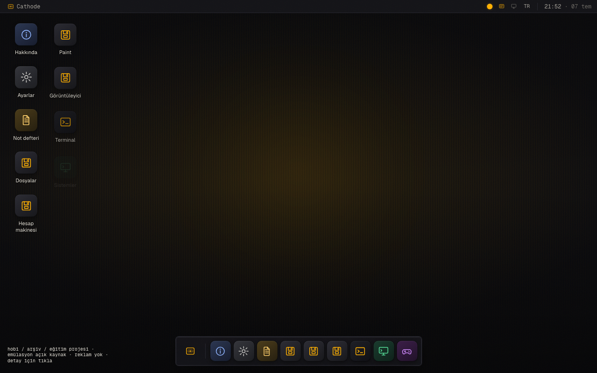
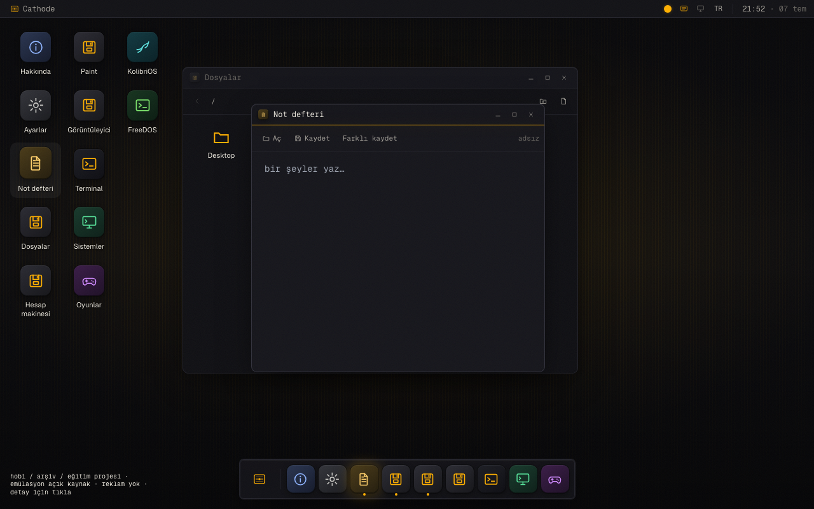
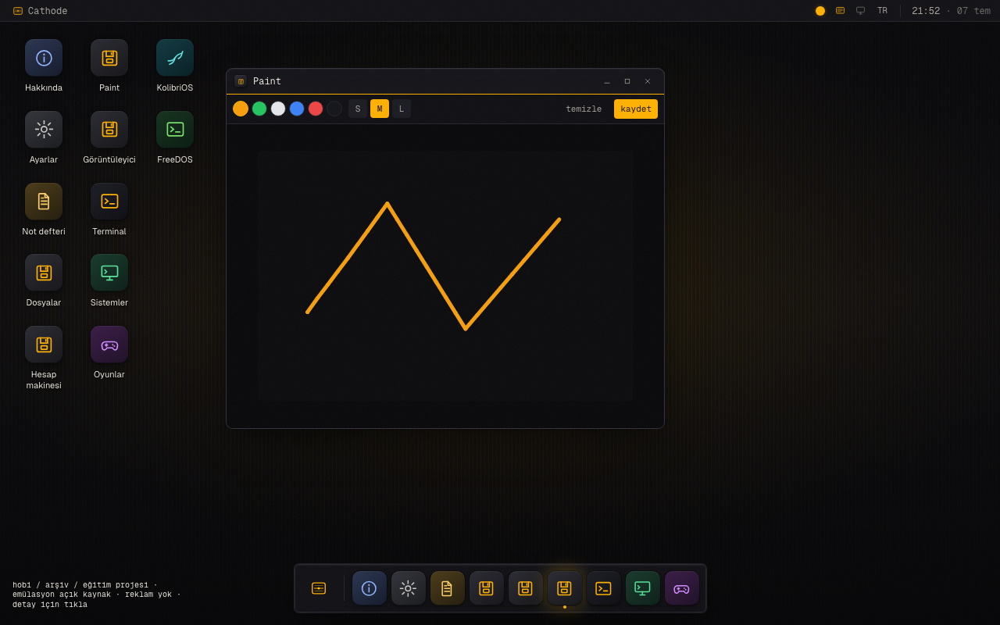
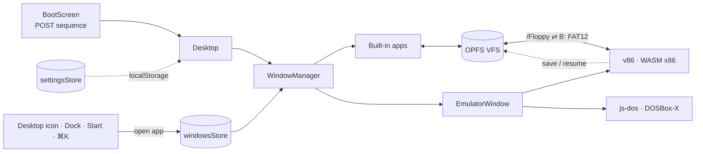

<div align="center">



<br />


<br /><br />

**Bespoke desktop chrome meets real x86 emulation — entirely in your browser.**
<br />
<sub>No account. No database. No analytics. Every byte of state stays on your machine.</sub>

<br /><br />

[**Features**](#-features) · [**Quick start**](#-quick-start) · [**How it works**](#-how-it-works) · [**Deploy**](#%EF%B8%8F-deployment) · [**Report a bug**](https://github.com/kutluhangil/Cathode/issues)

</div>


## 🇹🇷 Kısaca

**Retrograde**, tarayıcıda çalışan, tamamen özgün tasarımlı bir retro işletim sistemi kabuğudur. İki katmandan oluşur:

- **Kabuk** — boot ekranı, masaüstü, pencere yöneticisi, dock ve dahili uygulamalarla (Terminal, Dosyalar, Not Defteri, Paint, Hesap Makinesi, Medya Oynatıcı, Tarayıcı…) kendine ait *Obsidian Retrograde* arayüzü.
- **Emülasyon** — WebAssembly tabanlı **v86** ile gerçek eski işletim sistemleri (KolibriOS, FreeDOS) ve **js-dos** (DOSBox-X) ile DOS yazılımları (DOOM shareware dahil), izole bir pencerede. `/Floppy` klasöründeki dosyalar **B: disketi** olarak emüle DOS'a takılır, DOS'ta yapılan değişiklikler geri yazılır.

Emüle edilen sistemler internete bağlı değildir, modern makineye erişemez. Login, veritabanı, analytics, reklam yok; ayarlar `localStorage`'da, dosyalar tarayıcının OPFS'inde durur ve tek tıkla `.zip` yedeği alınıp geri yüklenebilir. Tek sunucu bileşeni İnternet uygulamasının durumsuz, sandbox'lı proxy'sidir. Arayüz **Türkçe / İngilizce**, PWA olarak offline çalışır. Telifli sistemler (örn. Windows) sitede barındırılmaz — yalnızca kullanıcının kendi imajıyla (BYOI) açılır.


## ✦ What is Retrograde?

Retrograde is **not** a skin over someone else's OS. The boot sequence, desktop, window manager, dock and every built-in app are an original interface called **Obsidian Retrograde** — amber phosphor, CRT scanlines, a physical *Retrograde 5100* monitor bezel.

Underneath, real legacy systems boot on emulated hardware: **v86** runs a genuine x86 machine over WebAssembly, **js-dos** runs classic DOS software. Both are sandboxed — no network, no access to the host.

<div align="center">
<br />

<br />
<sub>The real boot sequence — CRT warm-up → POST → device probes → phosphor bloom → desktop.</sub>
<br /><br />
</div>

## ⚡ Features

<table>
<tr>
<td width="50%" valign="top">

#### 🖥️ The shell
- **Window manager** — drag, resize from any edge, snap to half-screen, `Alt+Tab` switcher
- **Command Palette** — `Cmd/Ctrl+K` fuzzy launcher for every app and action
- **Desktop** — draggable, persistent icons, right-click context menu, multi-select
- **Dock + Start menu + system bar** — one store drives every entry point
- **Deep links** — `?open=kolibri` or `?open=terminal,notepad` launches apps on load
- **Drag & drop** — drop files from your computer onto the desktop or into Files
- **Screensaver** — phosphor bouncing mark after 3 min idle
- **Mobile mode** — single-window layout on small screens

</td>
<td width="50%" valign="top">

#### 💾 The emulators
- **v86 (WASM x86)** — KolibriOS and FreeDOS boot out of the box
- **js-dos (DOSBox-X)** — classic, freely-licensed DOS software
- **Auto sleep / resume** — state saved on close, restored on reopen
- **Multi-instance** — several machines at once, with a perf warning
- **B: floppy bridge** — files in `/Floppy` become a FAT12 disk in FreeDOS / KolibriOS; eject writes changes back
- **DOOM shareware** — id's v1.9 shareware episode, served unmodified
- **BYOI / BYOG** — bring your own disk image or `.jsdos` bundle
- Large images stream via **HTTP range requests** from Cloudflare R2

</td>
</tr>
<tr>
<td width="50%" valign="top">

#### 🧩 The apps
| | |
|---|---|
| `>_` **Terminal** | `ls`, `cd`, `cat`, `mkdir`, `rm`, `open`, `accent`, `neofetch`… |
| `▤` **Files** | OPFS virtual filesystem — upload, download, drag & drop |
| `▱` **Notepad** | persistent notes, saved to the VFS |
| `✎` **Paint** · `▨` **Image Viewer** · `=` **Calculator** | mini apps |
| `♪` **Media Player** | `/Music` playlist + phosphor oscilloscope |
| `🌐` **Browser** | retro web via a sandboxed, stateless `/api/proxy` |
| `▦` **Systems** · `✦` **Games** | OS + DOS catalogs |

</td>
<td width="50%" valign="top">

#### 🎛️ The feel
- **4 phosphor themes** — amber · green · blue · white
- **CRT stack** — scanlines, vignette, grain, glow, monitor bezel
- **UI sound engine** — Web Audio synthesis, zero audio files
- **Motion-aware** — honours `prefers-reduced-motion`
- **TR / EN** i18n · a11y baseline · focus traps
- **Installable PWA** — offline app shell via Serwist
- **Backup & restore** — every file, emulator save and setting as one `.zip`
- Easter eggs — try `↑↑↓↓←→←→BA`, or `xyzzy` in the terminal 👀

</td>
</tr>
</table>


## 🖼️ Screenshots

<div align="center">

| Desktop | Apps | Paint |
|:-:|:-:|:-:|
|  |  |  |

<sub>Regenerate with `CAPTURE=1 npm run test:e2e -- screenshots.spec.ts --project=desktop`</sub>

</div>

## 🛠️ Tech stack

```text
Shell        →  Next.js 14 (App Router) · TypeScript (strict) · Tailwind CSS · Framer Motion
State        →  Zustand — windows, desktop, files, settings, ui (localStorage-persisted)
Emulation    →  v86 (WASM x86) · js-dos 8 (DOSBox-X)
Filesystem   →  OPFS virtual filesystem — text + binary, metadata sidecar
Audio        →  Web Audio API — synthesized UI cues, no audio assets
PWA          →  @serwist/next — offline app shell, installable
i18n         →  Typed TR / EN dictionaries + useT() hook
Testing      →  Playwright e2e — desktop + mobile projects
Deployment   →  Docker (standalone) → nginx → Cloudflare Tunnel · large images on R2
```


## 🚀 Quick start

> Requires **Node.js ≥ 18**.

```bash
git clone https://github.com/kutluhangil/Cathode.git
cd Cathode

npm install      # postinstall prepares emulator binaries into public/
npm run dev      # → http://localhost:3000
```

Emulator binaries (v86 WASM, BIOS, js-dos, KolibriOS) are **not committed** — `npm run setup:emu` (run automatically on `postinstall`) generates them idempotently from `node_modules` plus free-license downloads.

| Script | What it does |
|---|---|
| `npm run dev` | Dev server on `localhost:3000` |
| `npm run build` | Production build (`output: standalone`) |
| `npm run start` | Serve the production build |
| `npm run lint` | ESLint |
| `npm run setup:emu` | Regenerate emulator binaries into `public/` |
| `npm run test:e2e` | Playwright suite (`test:e2e:ui` for the UI runner) |

## ☁️ Deployment

Retrograde ships as a self-hosted **Docker** image. The v86 emulator needs `SharedArrayBuffer`, which needs strict cross-origin headers — easiest to guarantee behind your own reverse proxy.

```bash
docker build -t retrograde .
docker run -p 3000:3000 retrograde
```

- `deploy/nginx.conf` — WASM MIME type, HTTP range requests, COOP/COEP preserved
- `deploy/R2.md` — hosting large disk images on Cloudflare R2

> [!NOTE]
> The Browser app's `/api/proxy` only fetches public `http(s)` URLs on ports 80/443 — private, loopback and link-local addresses (your LAN, `localhost`, cloud metadata) are refused at every redirect hop. Proxied pages run in a sandboxed iframe with an opaque origin, so they can never read Retrograde's `localStorage` or files.

> [!IMPORTANT]
> The emulator requires `Cross-Origin-Opener-Policy: same-origin` and `Cross-Origin-Embedder-Policy: credentialless` over HTTPS. They are set in `next.config.mjs` — any proxy in front of the app must not strip them.


## 📊 How it works



**The shell.** Boot plays once, then hands off to the desktop. Every window, the dock and the start menu are driven by a single Zustand `windowsStore` — opening an app from any entry point pushes the same window state. Settings (`accent`, `crt`, `monitor`, `motion`, `sound`, `screensaver`, `wallpaper`, `lang`) persist to `localStorage`.

**Emulation.** Each OS / game in `src/data/os.ts` and `src/data/games.ts` declares its engine, disk drive, memory profile and image source. Enabled entries become real desktop apps automatically; disabled ones show as *coming soon* until their image is hosted.

**Legal boundary.** No copyrighted OS image (e.g. Windows) is ever bundled or hosted. Windows-flavoured catalog cards only launch with an image the user supplies (BYOI) — Retrograde just provides the matching hardware profile.

<details>
<summary><b>📐 Project structure</b></summary>

```text
Cathode/
├── src/
│   ├── app/                  # layout, page (boot → desktop), sw.ts, api/proxy
│   ├── components/
│   │   ├── boot/             # BootScreen
│   │   ├── desktop/          # Desktop, Wallpaper, CommandPalette, Screensaver, ContextMenu
│   │   ├── window/           # Window, WindowManager, TitleBar, ResizeHandles, WindowSwitcher
│   │   ├── dock/             # Dock, StartMenu, SystemBar, Clock
│   │   ├── apps/             # Terminal, FileManager, Notepad, Paint, MediaPlayer, Browser…
│   │   │   └── emulator/     # LazyEmulator (v86), LazyJsDos, EmulatorWindow
│   │   └── ui/               # Button, Toggle, Segmented, AppIcon
│   ├── store/                # windows, desktop, files, settings, ui (Zustand)
│   ├── lib/                  # emu/ (v86, sessions, fat12), fs/ (OPFS), backup/ (zip), i18n/, sound
│   └── data/                 # apps registry, os catalog, games catalog, wallpapers
├── e2e/                      # Playwright specs (boot, fs, emu, a11y, mobile…)
├── public/                   # icons, wallpapers, (setup:emu →) v86, js-dos, images
├── deploy/                   # nginx.conf, R2.md
└── RETROGRADE_BUILD_SPEC.md  # phased build spec
```

</details>

## 🗺️ Roadmap

| | |
|:-:|---|
| ✅ | Boot screen, desktop, window manager, dock, start menu |
| ✅ | Terminal, Command Palette, Window Switcher, Screensaver |
| ✅ | v86 (KolibriOS + FreeDOS) and js-dos integration · BYOI / BYOG |
| ✅ | Files app + OPFS VFS · draggable persistent desktop icons |
| ✅ | Emulator auto sleep / resume · multi-instance |
| ✅ | Calculator, Paint, Image Viewer, Browser, Media Player |
| ✅ | Hardened Browser proxy (SSRF guard + sandboxed iframe) |
| ✅ | Terminal filesystem commands · Files upload / download / drag & drop |
| ✅ | `/Floppy` ⇄ B: floppy bridge for emulated DOS · DOOM shareware |
| ✅ | Full local backup & restore (.zip) · `?open=` deep links |
| ✅ | Playwright e2e · mobile mode · a11y · TR / EN |
| ✅ | 4 phosphor themes · easter eggs · installable PWA |
| 🔄 | ReactOS and more OS images hosted on R2 |
| 🔄 | More free / shareware DOS titles |


## ⚖️ Legal & content policy

Retrograde is a hobby / educational / digital-preservation project. All emulation engines are open source. Legacy operating systems belong to their copyright holders and run **only** for archival and nostalgia purposes, sandboxed in the browser. Content is removed on a rights holder's request. No ads, no commercial purpose. **Windows is never bundled.**

## 📄 License

[MIT](LICENSE). KolibriOS, FreeDOS and ReactOS are trademarks of their respective projects; this is an independent project, not affiliated with or endorsed by any of them.

## 🙏 Acknowledgements

[v86](https://github.com/copy/v86) · [js-dos](https://js-dos.com) · [KolibriOS](https://kolibrios.org) · [FreeDOS](https://freedos.org) · [ReactOS](https://reactos.org) · [SeaBIOS](https://www.seabios.org)

<div align="center">

<br />


Built by [**Kutluhan Gül**](https://github.com/kutluhangil) · *ReBuildReBreak*

<sub>If Retrograde made you nostalgic, leave a ⭐</sub>

</div>
